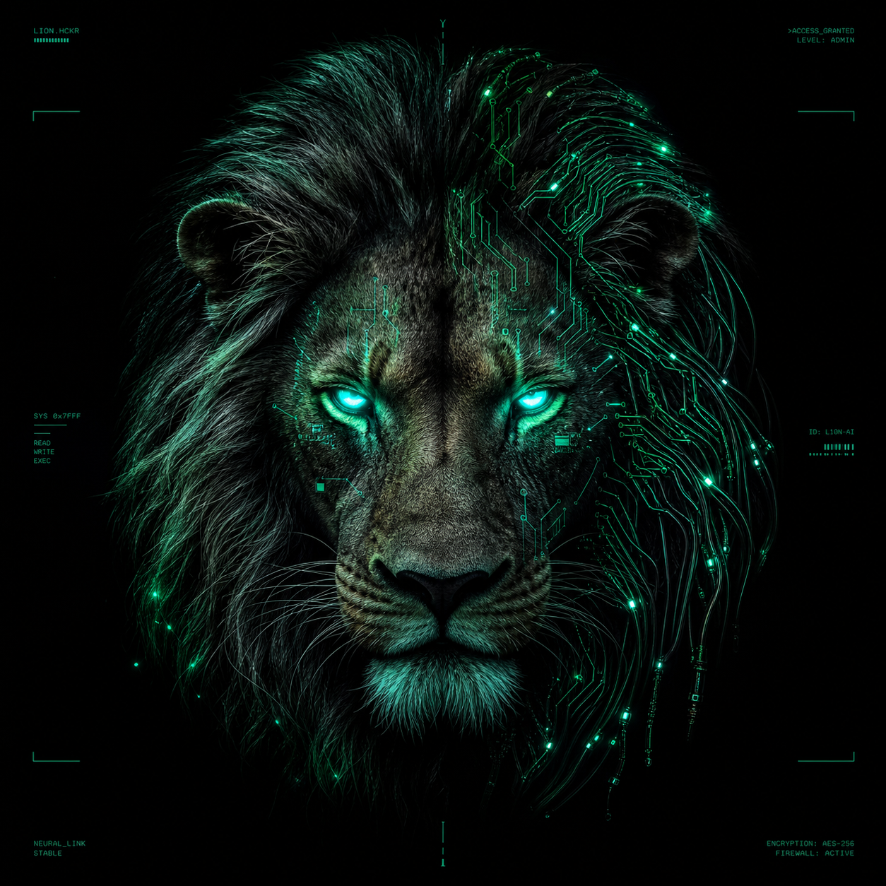

<div align="center">



# SysK69  `#IT`

**PRO HACKER** · membro del team **[Sh4d0wC4ts](https://app.hackthebox.com/teams/8832)** 😼

*"Curiosity didn't kill this cat — it got root."*

[](https://app.hackthebox.com/)
[](https://app.hackthebox.com/teams/8832)
[](https://sysk69.github.io/HTB-Writeups/)

</div>

---

### `whoami`

```text
Security engineer & developer.
Offensive security + building: non solo rompo le cose, le costruisco.
Pentest, automazione, tooling e app full-stack.
"Some shadows don't have a source."
```

### 🧰 Stack


### 🎯 Cosa faccio

- 🔴 **Offensive security** — Active Directory, Windows priv-esc, web/LLM exploitation, post-exploitation
- 🛠️ **Tooling & automazione** — infrastructure-as-code, scripting, workflow riproducibili
- 💻 **Sviluppo app** — web full-stack e strumenti da riga di comando
- 🎮 **CTF / HackTheBox / TryHackMe** — macchine Windows & Linux

### 📂 Progetti

| Repo | Cosa è | Link |
|------|--------|------|
| **[HTB-Writeups](https://github.com/SysK69/HTB-Writeups)** | Hub dei writeup CTF — tema coerente, passo-passo, PoC. Soluzioni di box non-retired su richiesta. | 🌐 [sito](https://sysk69.github.io/HTB-Writeups/) |
| **[Kali-Setup](https://github.com/SysK69/Kali-Setup)** | Ambiente Kali da pentest **riproducibile come codice**: setup dichiarativo e idempotente, sincronizzazione multi-host dei tool. | 🌐 [sito](https://sysk69.github.io/Kali-Setup/) |

### 📝 Writeup

I miei writeup CTF (tema coerente, passo-passo, PoC inclusi) vivono qui:

> 🌐 **[sysk69.github.io/HTB-Writeups](https://sysk69.github.io/HTB-Writeups/)**

I writeup di macchine **non ancora ritirate** restano privati e si sbloccano **su richiesta**;
diventano pubblici al **retire** (policy HTB).

---

<div align="center"><sub>😼 Sh4d0wC4ts — "Some shadows don't have a source."</sub></div>
